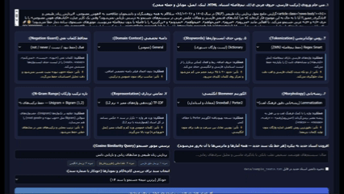

# 🧠 Multilingual NLP Studio: Preprocessing, Vector Representation, Classical ML, Transformers & Interactive UI

[English](#-english) | [فارسی](#-فارسی)

---

# 🌐 English

An end-to-end, modular, and interactive **Natural Language Processing (NLP)** laboratory and web application engineered for **Persian, Arabic-script normalization, and English** corpora.

This project implements and compares **both classical and modern NLP paradigms** across every single stage—from raw text ingestion and 4-level Unicode/ZWNJ normalization to **5 Stopword Detection strategies** (Dictionary, Statistical IDF, Domain-Specific, Machine Learning Classifier, and Hybrid), **Stemming vs. Lemmatization**, **Bag-of-Words vs. Smooth TF-IDF** with **Sparsity/Memory Analytics** and **Typo-Tolerant Cosine Search**, and **6 Classification Architectures** (Rule-Based Lexicon, Multinomial Naive Bayes, Logistic Regression, Linear SVM, Random Forest Ensemble, and Transformer Self-Attention), complete with a **zero-dependency Web UI (`app_ui.py`)**, **CLI switches**, **Audit JSON reports**, and a pre-executed **Jupyter Presentation Notebook**.

## 🏗️ System Architecture

```
                     +----------------------------------------+
                     |         Raw Multilingual Corpus        |
                     | (Persian / Arabic Script / English)    |
                     +-------------------+--------------------+
                                         |
                                         v
                     +----------------------------------------+
                     | 1. Text Cleaning Layer (cleaner.py)    |
                     | • HTML Unescape & Tag Stripping        |
                     | • Invisible Unicode Removal (ZWSP/BOM) |
                     | • URL / Email / Mention / PII Tokens   |
                     +-------------------+--------------------+
                                         |
                                         v
                     +----------------------------------------+
                     | 2. 4-Level Normalization (normalizer.py|
                     | • Unicode NFKC + Arabic->Persian Map   |
                     | • Diacritics & Kashida Stripping       |
                     | • ZWNJ Rules (می/نمی & ها/تر/ترین)     |
                     | • Colloquial->Formal & Elongation Fix  |
                     +-------------------+--------------------+
                                         |
                                         v
                     +----------------------------------------+
                     | 3. Smart Tokenization (tokenizer.py)   |
                     | • Abbreviation-Safe Sentence Splitter  |
                     | • Regex Smart / NLTK / Hazm / BPE Demo |
                     | • Overlap-Aware Text Chunking          |
                     +-------------------+--------------------+
                                         |
                                         v
                     +----------------------------------------+
                     | 4. 5-Method Stopwords Filter           |
                     | • Dictionary / Statistical IDF         |
                     | • Domain-Specific (Med/Legal/Sports..) |
                     | • ML Stopword Classifier (TF/IDF/Len)  |
                     | • Negation Guard ('not', 'نبود', 'نیست')|
                     +-------------------+--------------------+
                                         |
                                         v
                     +----------------------------------------+
                     | 5. Morphology (stemmer_lemmatizer.py)  |
                     | • Stemming (Porter/Snowball/Lancaster) |
                     | • Lemmatization (POS + Persian Verbs)  |
                     +-------------------+--------------------+
                                         |
                                         v
                     +----------------------------------------+
                     | 6. Vectorization & 6-Model Benchmark   |
                     | • BoW vs. Smooth L2 TF-IDF + Sparsity  |
                     | • Exact + Typo-Tolerant Cosine Search  |
                     | • Rule-Based, NB, LR, SVM, RF & Transf.|
                     | • Web UI (app_ui.py) + JSON + Jupyter  |
                     +----------------------------------------+
```
## 📷 Preview


## 🌟 Key Technical Highlights

* **Interactive Web UI (`app_ui.py`)**: Runs out-of-the-box via Python's built-in HTTP server (`http://127.0.0.1:7860`) with zero mandatory installations, supporting multi-document addition, live parameter hints, Token/Vocabulary Funnel charts, Document-Term Matrix tables, Cosine Similarity heatmaps, and Ablation comparisons.
* **Head-to-Head Comparison of 6 Model Families (`models_comparator.py`)**: Evaluates 6 distinct paradigms on a nuanced 48-sentence bilingual benchmark (`32 Train / 16 Test`) using `Accuracy`, `Precision`, `Recall`, `F1-Score`, and `Confusion Matrix`:
  1. **Rule-Based Lexicon Classifier** (with negation-window reversal rules)
  2. **Statistical Multinomial Naive Bayes** (with Laplace smoothing)
  3. **Classical ML — Logistic Regression** (L2-regularized gradient descent)
  4. **Classical ML — Linear SVM** (Hinge-loss margin classifier)
  5. **Classical Ensemble — Random Forest** (illustrating tree limitations on high-dimensional sparse text matrices)
  6. **Transformer Architecture** (offline contextual self-attention encoder with optional Hugging Face pipeline support)
* **Exact & Typo-Tolerant Search Engine + Dense Token Vectors (`vectorizer.py`, `pipeline.py`)**: Ranks documents via `TF-IDF` Cosine Similarity, automatically falls back to phonetic/bigram character similarity for spelling variations (e.g., `ذوغ` matching `دوغ`), and computes multi-dimensional L2-normalized dense vectors (`[0.224, -0.524, ...]`) per query token alongside pooled query representations.
* **All 5 Stopword Identification Strategies**: Switch between `dictionary`, `statistical_idf` ($IDF = \log(N/df)$), `domain_specific` (`medical`, `legal`, `sports`, `scientific`, `ecommerce`), `ml_classifier`, and `hybrid`, while protecting negations (`نبود`, `نیست`, `not`).
* **Complete Arabic-to-Persian Unification & ZWNJ Repair**: Combines `Unicode NFKC` with full Arabic-to-Persian character mapping (`ي`/`ى` $
ightarrow$ `ی`, `ك` $
ightarrow$ `ک`, `ة` $
ightarrow$ `ه`, `أ`/`إ`/`ٱ` $
ightarrow$ `ا`, `ؤ` $
ightarrow$ `و`), digit unification, diacritic/kashida stripping, and rule-based half-space (`ZWNJ`) correction.

## 🛠️ Comparison: Classical vs. Modern Methods Supported in Every Stage

| Pipeline Stage | Classical / Rule-Based Options | Statistical / ML / Modern Options |
| :--- | :--- | :--- |
| **Tokenization** | `whitespace`, `regex_smart` (Rule-based ZWNJ) | `nltk`, `hazm`, `subword_bpe_demo` (Transformer Subwords) |
| **Stopwords Removal** | `dictionary`, `domain_specific` (6 domains) | `statistical_idf` ($\log(N/df)$), `ml_classifier`, `hybrid` |
| **Morphology** | `stem` (`porter`, `snowball`, `lancaster`, Farsi rules) | `lemma` (Dictionary/POS + Persian verb root mapping) |
| **Representation** | `bow` (CountVectorizer) | `tfidf` (Smooth IDF + L2 Norm + Bigrams + Sparse CSR) |
| **Classification** | `Rule-Based Lexicon` | `Naive Bayes`, `Logistic Regression`, `Linear SVM`, `Random Forest`, `Transformer` |

## 📂 Repository Layout

```text
nlp_pipeline_project/
├── app_ui.py                       # Interactive Web UI (zero-dependency built-in HTTP server with charts & heatmaps)
├── NLP_Pipeline_Presentation.ipynb # Pre-executed Jupyter Notebook covering all 8 stages & 6 models
├── main.py                         # CLI entry point with live switches for models, stages & Web UI
├── requirements.txt                # Optional dependencies (Gradio, Transformers, NLTK, Hazm)
├── README.md                       # Complete bilingual documentation (English & Persian)
├── data/
│   └── sample_texts.txt            # Challenging bilingual test corpus (7 multi-scenario documents)
├── src/
│   ├── __init__.py
│   ├── config.py                   # Central switches for all 8 pipeline & modeling stages
│   ├── cleaner.py                  # Stage 2: HTML, invisible Unicode, PII, URL/Email & punctuation cleaner
│   ├── normalizer.py               # Stage 3: 4-level Unicode, Arabic->Persian, ZWNJ & colloquial normalizer
│   ├── tokenizer.py                # Stage 4: Abbreviation-safe sentence splitter, Regex/NLTK/Hazm/BPE & chunking
│   ├── stopwords_handler.py        # Stage 5: Dictionary, Statistical IDF, Domain, ML & Hybrid stopwords
│   ├── stemmer_lemmatizer.py       # Stage 6: Porter/Snowball/Lancaster stemming & POS/Persian lemmatization
│   ├── vectorizer.py               # Stage 7: BoW, Smooth L2 TF-IDF, Sparsity analytics & Exact/Fuzzy Cosine Search
│   ├── models_comparator.py        # Stage 8: Rule-Based, Naive Bayes, Logistic Regression, SVM, Random Forest & Transformer
│   └── pipeline.py                 # End-to-end orchestrator, deduplication & Audit/Evidence generator
└── outputs/
    └── nlp_audit_report.json       # Full JSON report including benchmark metrics & stage-by-stage audit
```

## 🚀 Step-by-Step Installation

### Prerequisites
* Python `3.10` or higher.
* Note: Both the **CLI pipeline (`main.py`)** and the **Web UI (`app_ui.py`)** run out-of-the-box with **zero external installations** (Python Standard Library only). Installing `requirements.txt` enables optional `NLTK` and `Hazm` modes.

### Online vs. Offline Mode (`HF_HUB_OFFLINE`)
* **Offline Mode (Default / Fast, Zero Large Downloads)**: By default, `hf_model_name` in `src/config.py` is set to `""` so the pipeline runs immediately without downloading large transformer weights [cite: 192]. You can also enforce offline mode via environment variables:
  * **Windows (CMD)**: `set HF_HUB_OFFLINE=1`
  * **Windows (PowerShell)**: `$env:HF_HUB_OFFLINE="1"`
  * **Linux / macOS**: `export HF_HUB_OFFLINE=1`
* **Online Hugging Face Mode**: To use a live pretrained model from Hugging Face Hub, set `hf_model_name` in `src/config.py` (for example `"HooshvareLab/bert-fa-base-uncased-sentiment-digikala"`) and ensure `HF_HUB_OFFLINE` is `0` or unset (unset `HF_HUB_OFFLINE=1` / set `HF_HUB_OFFLINE=0`) [cite: 149].


### Method 1: Fast Installation with `uv` (Recommended)

```bash
# 1. Navigate to the project directory
cd nlp_pipeline_project

# 2. Create a virtual environment using uv
uv venv

# 3. Activate the virtual environment
# On Windows (CMD / PowerShell):
.venv\Scripts\activate
# On Linux / macOS:
source .venv/bin/activate

# 4. Install optional NLP packages
uv pip install -r requirements.txt
```

### Method 2: Standard Installation with `pip`

```bash
# 1. Navigate to the project directory
cd nlp_pipeline_project

# 2. Create a standard virtual environment
python -m venv .venv

# 3. Activate the virtual environment
# On Windows (CMD / PowerShell):
.venv\Scripts\activate
# On Linux / macOS:
source .venv/bin/activate

# 4. Install optional NLP packages
pip install -r requirements.txt
```

## 💡 How to Use (Web UI, CLI & Jupyter Notebook)

### 1. Launch the Interactive Web UI

```bash
python app_ui.py
# Or via main.py:
python main.py --ui
```
Open **`http://127.0.0.1:7860`** in your browser to add custom documents, switch between algorithms, inspect charts and heatmaps, and compare all 6 classifiers live.

### 2. Run via Command Line (CLI Switches)

```bash
# Default run (Full 6-stage preprocessing + TF-IDF + 6-Model Benchmark)
python main.py

# Switch to Domain-Specific stopwords (Medical) and Porter Stemming with Bag-of-Words
python main.py --stopwords domain_specific --domain medical --morph stem --en-stemmer porter --rep bow

# Switch to ML-based stopword detection and Subword (BPE) tokenization
python main.py --stopwords ml_classifier --tokenizer subword_bpe_demo

# Test removing negations in sentiment analysis
python main.py --keep-negations false
```

### 3. Run Interactive Jupyter Notebook

```bash
jupyter notebook NLP_Pipeline_Presentation.ipynb
```

## 👤 Author & Maintainer

**Mehran Asgari Roozbahani**
* **GitHub**: [@imehranasgari](https://github.com/imehranasgari)
* **Specialization**: Natural Language Processing, Machine Learning Pipelines & AI Engineering

## 📄 License

This project is licensed under the [MIT License](LICENSE).

---

# 🇮🇷 فارسی

[English](#-english) | [فارسی](#-فارسی)

یک آزمایشگاه و اپلیکیشن تحت وب جامع، ماژولار و تعاملی برای **پردازش زبان طبیعی (NLP)** که به‌طور ویژه برای **زبان فارسی، یکسان‌سازی نویسه‌های عربی و متون انگلیسی** طراحی شده است.

این پروژه **هر دو رویکرد کلاسیک و مدرن NLP** را در تمام مراحل پیاده‌سازی و با یکدیگر مقایسه می‌کند؛ از دریافت متن خام و نرمال‌سازی ۴ سطحی یونیکد و نیم‌فاصله گرفته تا **۵ روش شناسایی ایست‌واژه‌ها** (دیکشنری، آماری IDF، مبتنی بر دامنه، یادگیری ماشین و ترکیبی)، **ریشه‌یابی Stemming در برابر Lemmatization**، **نمایش برداری Bag-of-Words در برابر TF-IDF** همراه با **تحلیل حافظه ماتریس خلوت (Sparse)** و **جستجوی کسینوسی مقاوم در برابر غلط املایی**، و **۶ خانواده مدل طبقه‌بندی** (قانون‌محور Lexicon، بیز ساده آماری Naive Bayes، رگرسیون لجستیک، ماشین بردار پشتیبان SVM، جنگل تصادفی Random Forest و معماری Transformer)، همراه با **رابط کاربری گرافیکی تحت وب (`app_ui.py`)** بدون نیاز به نصب پکیج خارجی، **سوییچ‌های خط فرمان (CLI)**، **گزارش تحلیلی JSON** و **نوت‌بوک تعاملی Jupyter**.

## 🏗️ معماری سیستم (System Architecture)

```
                     +----------------------------------------+
                     |         Raw Multilingual Corpus        |
                     |   (متن خام فارسی، عربی و انگلیسی)     |
                     +-------------------+--------------------+
                                         |
                                         v
                     +----------------------------------------+
                     | 1. Text Cleaning Layer (cleaner.py)    |
                     | • باز کردن HTML Entity و حذف تگ‌ها      |
                     | • حذف نویسه‌های نامرئی (ZWSP / BOM)     |
                     | • نشانه ثابت برای URL / Email / PII    |
                     +-------------------+--------------------+
                                         |
                                         v
                     +----------------------------------------+
                     | 2. 4-Level Normalization (normalizer.py|
                     | • یونیکد NFKC + نگاشت عربی به فارسی    |
                     | • حذف اعراب و خط کشیده (ـ)             |
                     | • اصلاح نیم‌فاصله (می/نمی و ها/تر/ترین) |
                     | • تبدیل محاوره به رسمی و حروف تکراری   |
                     +-------------------+--------------------+
                                         |
                                         v
                     +----------------------------------------+
                     | 3. Smart Tokenization (tokenizer.py)   |
                     | • جمله‌بندی امن (حفظ Dr. و 3.14)       |
                     | • سوییچ بین Regex / NLTK / Hazm / BPE  |
                     | • قطعه‌بندی هوشمند با همپوشانی (Chunking)|
                     +-------------------+--------------------+
                                         |
                                         v
                     +----------------------------------------+
                     | 4. 5-Method Stopwords Filter           |
                     | • دیکشنری / آماری IDF / دامنه تخصصی     |
                     | • طبقه‌بند ML (ویژگی TF/IDF/طول کلمه)  |
                     | • محافظ کلمات نفی ('نبود', 'نیست', 'not')|
                     +-------------------+--------------------+
                                         |
                                         v
                     +----------------------------------------+
                     | 5. Morphology (stemmer_lemmatizer.py)  |
                     | • ریشه‌یابی سریع (Porter/Snowball/Farsi)|
                     | • ریشه‌یابی دقیق (POS + بن افعال فارسی) |
                     +-------------------+--------------------+
                                         |
                                         v
                     +----------------------------------------+
                     | 6. Vectorization & 6-Model Benchmark   |
                     | • نمایش برداری BoW و TF-IDF + تحلیل رم |
                     | • جستجوی کسینوسی دقیق و مقاوم به املا   |
                     | • مقایسه Rule-Based, NB, LR, SVM, RF, TR|
                     | • رابط وب (app_ui.py) + JSON + Jupyter |
                     +----------------------------------------+
```
## 📷 پیش نمایش


## 🌟 ویژگی‌های فنی برجسته

* **رابط کاربری گرافیکی تحت وب (`app_ui.py`):** اجرا بدون نیاز به نصب هیچ کتابخانه خارجی با سرور داخلی پایتون (**`http://127.0.0.1:7860`**) شامل امکان افزودن هم‌زمان چندین سند جدید به پیکره، راهنمای زنده پارامترها، نمودار قیف کاهش واژگان، جدول ماتریس سند-واژه، نقشه حرارتی شباهت کسینوسی و مقایسه Ablation.
* **مقایسه هم‌زمان ۶ خانواده مدل کلاسیک و مدرن (`models_comparator.py`):** ارزیابی ۶ رویکرد مختلف روی دیتاست ۴۸ جمله‌ای چالش‌برانگیز (`۳۲ آموزش / ۱۶ آزمون`) با معیارهای `Accuracy`، `Precision`، `Recall`، `F1-Score` و `Confusion Matrix`:
  1. **طبقه‌بند قانون‌محور (Rule-Based Lexicon)** همراه با قوانین معکوس‌سازی نفی در پنجره متنی
  2. **مدل آماری بیز ساده چندجمله‌ای (Multinomial Naive Bayes)** با هموارسازی لاپلاس
  3. **یادگیری ماشین کلاسیک — رگرسیون لجستیک (Logistic Regression)** با منظم‌سازی L2
  4. **یادگیری ماشین کلاسیک — ماشین بردار پشتیبان خطی (Linear SVM)** با تابع زیان Hinge
  5. **یادگیری ماشین تجمعی — جنگل تصادفی (Random Forest Ensemble)** (نمایش علمی محدودیت درخت‌های تصمیم روی ماتریس‌های خلوت `TF-IDF`)
  6. **معماری مدرن ترنسفورمر (Transformer Self-Attention)** با شبیه‌ساز توجه متنی آفلاین و پشتیبانی اختیاری از Hugging Face
* **موتور جستجوی کسینوسی دقیق و مقاوم در برابر غلط املایی + بردار چندبُعدی هر توکن (`vectorizer.py`، `pipeline.py`):** رتبه‌بندی اسناد بر پایه شباهت کسینوسی `TF-IDF` همراه با تطابق تقریبی/آوایی خودکار هنگام بروز غلط املایی (مثل `ذوغ` با `دوغ`) و تولید بردار اعشاری چندبُعدی نرمال‌شده (`[0.224, -0.524, ...]`) برای تک‌تک توکن‌های پرسش و بردار میانگین پرسش.
* **پشتیبانی از هر ۵ روش شناسایی ایست‌واژه‌ها:** امکان سوییچ بین `dictionary`، `statistical_idf` ($IDF = \log(N/df)$)، `domain_specific` (۶ دامنه پزشکی، حقوقی، ورزشی، علمی، فروشگاهی و عمومی)، `ml_classifier` و `hybrid` همراه با محافظت از کلمات نفی (`نبود`، `نیست`، `not`).
* **یکسان‌سازی کامل خط عربی و فارسی و اصلاح نیم‌فاصله:** ترکیب `Unicode NFKC` با نگاشت کامل حروف عربی به فارسی (`ي`/`ى` $
ightarrow$ `ی`، `ك` $
ightarrow$ `ک`، `ة` $
ightarrow$ `ه`، `أ`/`إ`/`ٱ` $
ightarrow$ `ا`، `ؤ` $
ightarrow$ `و`)، یکسان‌سازی ارقام، حذف اعراب و کشیده و اصلاح قاعده‌مند نیم‌فاصله (`ZWNJ`).

## 🛠️ مقایسه: روش‌های کلاسیک در برابر روش‌های مدرن در هر مرحله

| مرحله پایپ‌لاین | گزینه‌های کلاسیک و قانون‌محور | گزینه‌های آماری، یادگیری ماشین و مدرن |
| :--- | :--- | :--- |
| **توکنایزیشن (Tokenization)** | `whitespace`، `regex_smart` (قواعد نیم‌فاصله) | `nltk`، `hazm`، `subword_bpe_demo` (زیرواژه ترنسفورمر) |
| **حذف ایست‌واژه (Stopwords)** | `dictionary`، `domain_specific` (۶ دامنه تخصصی) | `statistical_idf` ($\log(N/df)$)، `ml_classifier`، `hybrid` |
| **ریشه‌یابی (Morphology)** | `stem` (`porter`، `snowball`، `lancaster`، قواعد فارسی) | `lemma` (فرهنگ لغت/POS + بن افعال فارسی) |
| **نمایش برداری (Representation)** | `bow` (کیسه کلمات CountVectorizer) | `tfidf` (TF-IDF هموارشده با نرم L2 و Sparse CSR) |
| **طبقه‌بندی (Classification)** | `Rule-Based Lexicon` (قواعد دستی) | `Naive Bayes`، `Logistic Regression`، `Linear SVM`، `Random Forest`، `Transformer` |

## 📂 ساختار فولدر پروژه

```text
nlp_pipeline_project/
├── app_ui.py                       # رابط کاربری گرافیکی تحت وب (بدون نیاز به نصب پکیج با نمودار و ماتریس)
├── NLP_Pipeline_Presentation.ipynb # نوت‌بوک جوپیتر تعاملی و از پیش اجراشده برای ارائه مرحله‌به‌مرحله
├── main.py                         # نقطه شروع خط فرمان (CLI) با سوییچ زنده مدل‌ها، مراحل و اجرای UI
├── requirements.txt                # کتابخانه‌های اختیاری (Gradio، Transformers، NLTK و Hazm)
├── README.md                       # مستندات کامل دوزبانه (انگلیسی و فارسی)
├── data/
│   └── sample_texts.txt            # مجموعه داده‌های چالش‌برانگیز دوزبانه (۷ سند با سناریوهای متنوع)
├── src/
│   ├── __init__.py
│   ├── config.py                   # تنظیمات مرکزی و سوییچ‌های تغییر روش در تمام ۸ مرحله
│   ├── cleaner.py                  # مرحله ۲: پاک‌سازی HTML، نویسه‌های نامرئی، PII، لینک و علائم نگارشی
│   ├── normalizer.py               # مرحله ۳: نرمال‌سازی ۴ سطحی یونیکد، عربی به فارسی، ZWNJ و محاوره
│   ├── tokenizer.py                # مرحله ۴: جمله‌بندی امن، توکنایزر Regex/NLTK/Hazm/BPE و Chunking
│   ├── stopwords_handler.py        # مرحله ۵: حذف ایست‌واژه (دیکشنری، آماری IDF، دامنه، ML و ترکیبی)
│   ├── stemmer_lemmatizer.py       # مرحله ۶: ریشه‌یابی Porter/Snowball/Lancaster و Lemmatization فارسی/انگلیسی
│   ├── vectorizer.py               # مرحله ۷: نمایش برداری BoW و TF-IDF هموارشده، تحلیل Sparsity و جستجوی کسینوسی
│   ├── models_comparator.py        # مرحله ۸: مقایسه Rule-Based، Naive Bayes، Logistic Regression، SVM، RF و Transformer
│   └── pipeline.py                 # هماهنگ‌کننده کامل مراحل، تشخیص تکراری‌ها و تولید گزارش Audit JSON
└── outputs/
    └── nlp_audit_report.json       # خروجی کامل JSON شامل مقایسه دقت مدل‌ها و شواهد تمام مراحل
```

## 🚀 راهنمای نصب گام‌به‌گام

### پیش‌نیازها
* پایتون نسخه `3.10` یا بالاتر.
* نکته: هم **خط فرمان (`main.py`)** و هم **رابط کاربری تحت وب (`app_ui.py`)** بدون نیاز به نصب هیچ پکیج اضافه‌ای (فقط با کتابخانه استاندارد پایتون) اجرا می‌شوند. نصب `requirements.txt` حالت‌های اختیاری `NLTK` و `Hazm` را فعال می‌کند.

### حالت آنلاین و آفلاین (`HF_HUB_OFFLINE`)
* **حالت آفلاین و سریع (پیش‌فرض بدون دانلود سنگین):** به‌صورت پیش‌فرض، مقدار `hf_model_name` در فایل `src/config.py` روی `""` قرار دارد تا برنامه بدون نیاز به دانلود فایل‌های حجیم ترنسفورمر سریع اجرا شود [cite: 192]. همچنین برای اجبار به حالت آفلاین می‌توانید متغیر محیطی زیر را تنظیم کنید:
  * **ویندوز (CMD):** `set HF_HUB_OFFLINE=1`
  * **ویندوز (PowerShell):** `$env:HF_HUB_OFFLINE="1"`
  * **لینوکس و مک:** `export HF_HUB_OFFLINE=1`
* **حالت آنلاین (اتصال به Hugging Face Hub):** اگر بخواهید از یک مدل آماده روی Hugging Face استفاده کنید، نام مدل را در `src/config.py` وارد نمایید (مثلاً `"HooshvareLab/bert-fa-base-uncased-sentiment-digikala"`) و مطمئن شوید `HF_HUB_OFFLINE=1` ست نشده باشد (یا `set HF_HUB_OFFLINE=0` / `HF_HUB_OFFLINE=0` قرار دهید) [cite: 149].


### روش اول: نصب سریع با ابزار `uv` (پیشنهادی)

```bash
# ۱. ورود به پوشه پروژه
cd nlp_pipeline_project

# ۲. ساخت محیط مجازی با uv
uv venv

# ۳. فعال‌سازی محیط مجازی
# در ویندوز (CMD / PowerShell):
.venv\Scripts\activate
# در لینوکس و مک:
source .venv/bin/activate

# ۴. نصب پکیج‌های اختیاری NLP
uv pip install -r requirements.txt
```

### روش دوم: نصب استاندارد با ابزار `pip`

```bash
# ۱. ورود به پوشه پروژه
cd nlp_pipeline_project

# ۲. ساخت محیط مجازی استاندارد پایتون
python -m venv .venv

# ۳. فعال‌سازی محیط مجازی
# در ویندوز (CMD / PowerShell):
.venv\Scripts\activate
# در لینوکس و مک:
source .venv/bin/activate

# ۴. نصب پکیج‌های اختیاری NLP
pip install -r requirements.txt
```

## 💡 نحوه استفاده (Web UI، خط فرمان CLI و Jupyter)

### ۱. اجرای رابط کاربری گرافیکی تحت وب

```bash
python app_ui.py
# یا از طریق فایل اصلی:
python main.py --ui
```
سپس آدرس **`http://127.0.0.1:7860`** را در مرورگر باز کنید تا اسناد جدید اضافه کنید، بین روش‌های پیش‌پردازش سوییچ کنید و نمودارها و جدول‌ها را به‌صورت زنده مشاهده نمایید.

### ۲. اجرا از طریق خط فرمان (CLI Switches)

```bash
# اجرای پیش‌فرض (پیش‌پردازش ۶ مرحله‌ای + TF-IDF + مقایسه ۶ خانواده مدل)
python main.py

# سوییچ به ایست‌واژه‌های تخصصی دامنه پزشکی (Medical) و Porter Stemming با Bag-of-Words
python main.py --stopwords domain_specific --domain medical --morph stem --en-stemmer porter --rep bow

# سوییچ به تشخیص ایست‌واژه با یادگیری ماشین (ML) و توکنایزر Subword (BPE)
python main.py --stopwords ml_classifier --tokenizer subword_bpe_demo

# تست تأثیر حذف کلمات نفی در تحلیل احساسات
python main.py --keep-negations false
```

### ۳. اجرای نوت‌بوک تعاملی جوپیتر

```bash
jupyter notebook NLP_Pipeline_Presentation.ipynb
```

## 👤 نویسنده و توسعه‌دهنده (Author & Maintainer)

**مهران عسگری روزبهانی (Mehran Asgari Roozbahani)**
* **گیت‌هاب (GitHub)**: [@imehranasgari](https://github.com/imehranasgari)


## 📄 مجوز انتشار (License)

این پروژه تحت مجوز [MIT License](LICENSE) منتشر شده است.
